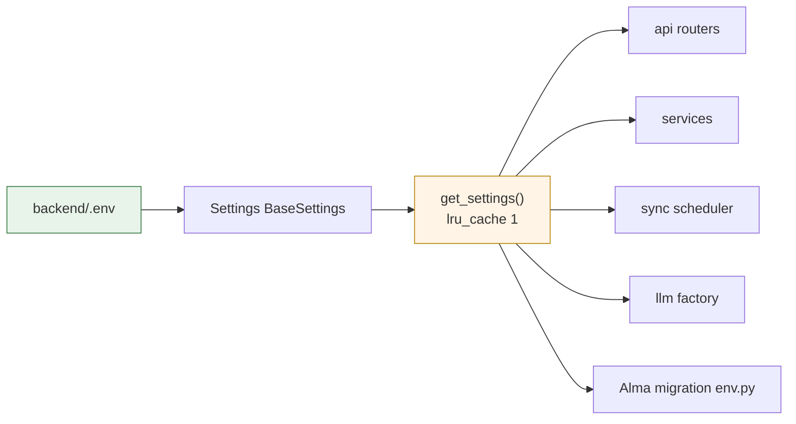

# Chapter 02 — System Architecture

> *How a request travels from a click to a rendered number, and the shape of the system
> at each layer.*

---

## 2.1 System context

MoneyPlant is a **modular monolith**: one database, one API service, one web app. No
microservices, no message queue, no distributed cache. The modules are separated by
*contract* (Pydantic schemas, pure function signatures), not by *network*.

```
┌──────────────────────────────────────────────────────────────────────────────┐
│                                                                              │
│    ┌──────────────────────────┐              ┌──────────────────────────┐    │
│    │   Next.js 14             │   HTTP/JSON │   FastAPI                │    │
│    │   apps/web (:3000)       │ ───────────► │   backend (:8000)        │    │
│    │                          │              │                          │    │
│    │   • App Router           │ ◄─────────── │   • 11 routers (/api)    │    │
│    │   • TanStack Query       │              │   • lifespan + scheduler │    │
│    │   • Zod on every response│              │   • CORS :3000           │    │
│    │   • Recharts             │              │                          │    │
│    └──────────────────────────┘              └───────────┬──────────────┘    │
│                                                            │                   │
│                                                            ▼                   │
│                                            ┌──────────────────────────────┐  │
│                                            │  SQLAlchemy 2 + Alembic      │  │
│                                            │  SQLite (default)            │  │
│                                            │  moneyplant.db               │  │
│                                            └──────────────────────────────┘  │
│                                                            ▲                   │
│    ┌──────────────────────────┐              ┌───────────┴──────────────┐    │
│    │   Browser                │              │  Optional providers       │    │
│    │   • no auth              │              │  • Ollama (local)         │    │
│    │   • workspace switch     │              │  • OpenAI                 │    │
│    │   • theme toggle         │              │  • Anthropic              │    │
│    └──────────────────────────┘              │  • Laya (soft assessment)  │    │
│                                              └──────────────────────────────┘  │
│                                                                              │
└──────────────────────────────────────────────────────────────────────────────┘
```

**External processes (all optional):**

```
  ┌───────────────┐    ┌────────────────┐    ┌─────────────────┐
  │    Ollama     │    │  OpenAI API    │    │  Anthropic API  │
  │  :11434/v1    │    │  (cloud)       │    │  (cloud)        │
  │  llama3.1:8b  │    │                │    │                 │
  └───────┬───────┘    └────────┬───────┘    └────────┬────────┘
          │                     │                     │
          └─────────────────────┴─────────────────────┘
                        │  httpx, lazily imported
                        ▼
              backend/app/services/llm/

  ┌───────────────┐
  │  Laya Router  │   optional pip package, deferred import
  │  (3 questions) │   falls back to heuristic "unavailable"
  └───────┬───────┘
          ▼
  backend/app/services/laya/adapter.py
```

---

## 2.2 The layering rule

Requests flow strictly downward. Each layer may call the layer directly below it and
nothing else.

```
┌─────────────────────────────────────────────────────────────┐
│  L4  apps/web/app/(app)/**/page.tsx                          │  React Server / Client
│      TanStack Query · Zod-validated fetch                    │
├─────────────────────────────────────────────────────────────┤
│  L3  backend/app/api/*.py                                    │  FastAPI routers
│      Pydantic in · Pydantic out · session lifecycle          │
├─────────────────────────────────────────────────────────────┤
│  L2  backend/app/services/**                                 │  Orchestration
│      decisions · simulation · sync · llm · laya · ingestion  │
├─────────────────────────────────────────────────────────────┤
│  L1  backend/app/engine/*  +  services/finance/*             │  PURE FUNCTIONS
│      Decimal math · no I/O · no globals · no LLM             │
├─────────────────────────────────────────────────────────────┤
│  L0  backend/app/models/*  +  app/db/*                       │  Persistence
│      SQLAlchemy 2 ORM · Alembic migrations                   │
└─────────────────────────────────────────────────────────────┘
```

**Why L1 is a hard boundary**

The rule engine, the scenario runner, the metrics computer, the alert evaluator, and the
financing matcher all live in L1 and are all pure. That is what makes the financial model
testable to the decimal (`backend/tests/test_metrics.py`, `test_inventory.py`,
`test_money.py`) and what makes the "rules decide, LLM explains" boundary enforceable —
there is no network call available to an L1 function even if it wanted one.

**The one deliberate exception:** `services/decisions/evaluator.py` sits in L2 and is the
only place where an L1 verdict, an Laya advisory, and their rendering coexist. It is
careful to compute the verdict *first* (`evaluator.py:96 evaluate_rules()`, then
`:97 aggregate_status()`) before touching anything advisory (`:102 assess_scenario()`).

---

## 2.3 Request lifecycle — a dashboard load

The dashboard is the densest page: six parallel queries. Here is what one of them does.

```
Browser                Next.js                    FastAPI              Engine           DB
   │                     │                          │                    │              │
   │  navigate /dash     │                          │                    │              │
   ├────────────────────►│                          │                    │              │
   │                     │                          │                    │              │
   │                     │  GET /api/businesses/    │                    │              │
   │                     │  {id}/dashboard-insights │                    │              │
   │                     ├─────────────────────────►│                    │              │
   │                     │                          │  load Business +   │              │
   │                     │                          │  Transactions ─────┼─────────────►│
   │                     │                          │◄───────────────────┼──────────────┤
   │                     │                          │                    │              │
   │                     │                          │  compute_metrics(  │              │
   │                     │                          │    transactions)   │              │
   │                     │                          ├───────────────────►│              │
   │                     │                          │  ◄ MonthlyAggregate│              │
   │                     │                          │    CategoryTotal   │              │
   │                     │                          │                    │              │
   │                     │                          │  build_dashboard_  │              │
   │                     │                          │   insights(inputs) │              │
   │                     │                          ├───────────────────►│              │
   │                     │                          │  ◄ Visual[]        │              │
   │                     │                          │    (id, title,     │              │
   │                     │                          │     what_it_shows, │              │
   │                     │                          │     evidence)      │              │
   │                     │                          │                    │              │
   │                     │  200 application/json    │                    │              │
   │                     │◄─────────────────────────┤                    │              │
   │                     │                          │                    │              │
   │                     │  schema.parse()  ← Zod   │                    │              │
   │                     │  throws if drifted       │                    │              │
   │                     │                          │                    │              │
   │  Recharts render    │                          │                    │              │
   │◄────────────────────┤                          │                    │              │
```

The key line is the last `build_dashboard_insights`. By the time a `Visual` leaves
`insights/engine.py`, every number in it is a pre-formatted string and every interpretive
sentence (`what_it_shows`, `what_to_notice`, `why_it_matters`) is written. The frontend's
only job is `Recharts` + `formatMoney`.

### The six dashboard queries

All six are issued in parallel by `apps/web/app/(app)/dashboard/page.tsx:127-190`:

| Query key | Endpoint | Feeds |
|---|---|---|
| `dashboard-insights` | `GET /api/businesses/{id}/dashboard-insights` | `KpiStrip`, all six charts |
| `financial-summary` | `GET /api/transactions/financial-summary` | `MonthSidePanel` fallback |
| `alerts` | `GET /api/businesses/{id}/alerts` | `AlertsPanel` |
| `financing-options` | `GET /api/businesses/{id}/financing-options` | `FinancingPanel` |
| `scenarios` | `GET /api/scenarios` | `ScenarioCompareView` |
| `ai-health` | `GET /api/ai/health` | provider chip, explain button state |

---

## 2.4 The decision pipeline

This is the flow that Principle 3 protects. Note the ordering — verdict first, LLM last,
and the LLM is on a *different endpoint*.

```
POST /api/decisions/evaluate
  { scenario_version_id }
        │
        ▼
┌───────────────────────────────────────────────────────────────────┐
│ services/decisions/evaluator.py:89  evaluate()                     │
│                                                                   │
│  1. Load ScenarioVersion → inputs_json + result_json               │
│  2. evaluate_rules(result, business)          engine.py:434        │
│         └─► 8 × RuleEvaluation{rule_id, severity, status, detail} │
│  3. aggregate_status(evaluations)            engine.py:438        │
│         └─► OverallStatus  ◄── VERDICT IS NOW FIXED              │
│  4. assess_scenario(result, rules, goal)      laya/adapter.py:98  │
│         └─► 3 × LayaAssessment  (ADVISORY ONLY)                  │
│  5. _extract_binding_constraints()  (hard + breached)             │
│  6. _extract_key_risks()            (soft + warning)              │
│  7. _build_recommendation(overall_status)                         │
│  8. DecisionReportRead                                                │
└───────────────────────────────────────────────────────────────────┘
        │
        ▼
   persist DecisionReport  ─────────────────────────────────────►  DB
        │
        ▼
   201 { id, overall_status, rule_evaluations, laya_assessments, ... }

   ── later, on user click (different request) ──

POST /api/decisions/{id}/explain
        │
        ▼
┌───────────────────────────────────────────────────────────────────┐
│ services/llm/factory.py:12  get_provider(mode)                    │
│   ├─ ollama / openai / anthropic                                 │
│   └─ health_check() → ProviderHealth{status, model, latency_ms}    │
│                                                                   │
│ build ExplanationContext  ← FROZEN PAYLOAD                        │
│   { business_industry, reporting_period, user_question,           │
│     computed_baseline, computed_scenarios, rule_evaluations,      │
│     laya_assessment?, assumptions, missing_information,           │
│     business_goal? }                                              │
│   ▲ raw transactions are NEVER included                          │
│                                                                   │
│ provider.explain(context) → Explanation                            │
│   { status, provider, model, summary, supporting_evidence,         │
│     key_risks, assumptions, missing_information, limitations }    │
└───────────────────────────────────────────────────────────────────┘
        │
        ▼
   200 Explanation   —  UI renders it BELOW the rule table,
                        with an explicit "the LLM can only explain" notice
```

**Critical property:** the `explain` endpoint cannot fail a decision. If the provider is
down it returns `Explanation{status: "unavailable", reason: "..."}` and the decision page
renders everything else normally.

---

## 2.5 The sync pipeline

The only part of the system with a background thread and external I/O.

```
  ┌────────────────────────────────────────────────────────────┐
  │  SyncScheduler  (daemon thread, lifespan-started)           │
  │  services/sync/scheduler.py:126                             │
  │                                                            │
  │   while not stopped:                                       │
  │       stop_event.wait(max(interval, 30))                    │
  │       for source in run_due_sources(session_factory):      │
  │           run_sync(session, source.id, trigger="scheduled") │
  └────────────────────────────┬───────────────────────────────┘
                               │
                               ▼
  ┌────────────────────────────────────────────────────────────┐
  │  is_due(source)                              scheduler.py:51│
  │    enabled AND schedule in {hourly, daily}                 │
  │    never synced            → due                           │
  │    hourly & >70 min stale  → due                           │
  │    daily  & >28 h stale    → due                           │
  └────────────────────────────┬───────────────────────────────┘
                               │
                               ▼
  ┌────────────────────────────────────────────────────────────┐
  │  run_sync(db, source_id, trigger)          service.py:91   │
  │                                                            │
  │   1. build connector (file | sql)                          │
  │   2. connector.read_rows(...)                              │
  │        file: path contained under file_source_root,         │
  │              .is_relative_to() traversal guard              │
  │        sql : SELECT-only, bound literals, row limit,       │
  │              statement timeout                             │
  │   3. map raw → canonical via DataSource.column_mapping      │
  │   4. parse_rows_for_sync(...)   ← SAME parser as CSV import │
  │   5. dedup: SHA-256 source_row_hash                        │
  │        in-memory set + uq_transactions_business_source_row_hash │
  │        SAVEPOINT per insert so a race rolls back one row    │
  │   6. update watermarks (file_content_sha256 / incremental_value) │
  │   7. persist SyncRun{rows_read, rows_added,                │
  │                      rows_skipped_duplicate,                │
  │                      rows_rejected, error_summary}          │
  │                                                            │
  │      error_summary is ALWAYS a synthetic code              │
  │      e.g. "read_failed:OperationalError"                    │
  └────────────────────────────┬───────────────────────────────┘
                               │
        ┌──────────────────────┴──────────────────────┐
        ▼                                             ▼
   Transaction rows                              SyncRun + DataSource
   (idempotent)                                  (counters + watermarks)
```

### Alternative entry point

Sites that prefer an external scheduler can skip the daemon entirely:

```bash
python -m scripts.sync_sources --all
python -m scripts.sync_sources --source <uuid>
python -m scripts.sync_sources --list
python -m scripts.sync_sources --all --dry-run
```

Wire that into Windows Task Scheduler or cron and set `SYNC_SCHEDULER_ENABLED=false`.

---

## 2.6 Data flow for ingestion (manual upload)

```
  file upload (multipart)
        │
        ▼
  POST /api/imports/preview
        │  1. extension + size check (upload_max_bytes = 10 MiB)
        │  2. encoding sniff: utf-8 → utf-8-sig → latin-1 (errors="replace")
        │  3. parse header row
        │  4. canonical_fields() → suggested mapping
        ▼
  { headers, suggested_mapping, sample_rows }
        │  ← UI shows the mapping, user confirms/adjusts
        ▼
  POST /api/imports/validate
        │  runs the SAME row parser used at commit time
        ▼
  { valid_rows, issues[] }        ← issues carry row + field + reason
        │
        ▼
  POST /api/imports/commit
        │  one transaction
        │  duplicate source_row_hash → counted as duplicate, not an error
        ▼
  ImportJob{status: "committed", rows_added, rows_skipped_duplicate, rows_rejected}
```

---

## 2.7 Cross-cutting concerns

### Configuration

`backend/app/core/config.py:18` defines a single `Settings(BaseSettings)` reading `backend/.env`.
`get_settings()` is `@lru_cache(maxsize=1)` (`config.py:99`) — one instance per process.



`GET /api/config/public` (`main.py:72`) exposes **safe booleans only** — whether Ollama
is reachable, whether an API key is present. Never a key, never a URL with credentials.

### Error handling

`main.py:115` installs a catch-all `Exception` handler returning HTTP 500 with body
`{"detail": "internal_error"}`. No stack trace, no SQL fragment, no file path escapes to
the client. Logging happens server-side (and is redacted when
`log_redact_financial = True`).

### CORS

`Settings.cors_origins_list` (`config.py:82`) defaults to `["http://localhost:3000"]`.
The backend is not intended to be internet-exposed without also tightening this and
adding auth — see chapter 14.

### Logging

`log_redact_financial` (`config.py:88`) wraps the logger so that any Decimal-looking
value bound to a money-ish field name is replaced with `<redacted>` at format time.
`LOG_LEVEL` defaults to `INFO`.

---

## 2.8 Deployment shapes

MoneyPlant is designed for a **pilot / local-first** deployment. Two supported shapes:

### Shape A — Local (default)

```
  ┌──────────────── one machine ────────────────┐
  │  uvicorn app.main:app :8000                 │
  │    └── in-process SyncScheduler (daemon)    │
  │  next start :3000                           │
  │  moneyplant.db                              │
  │  Ollama (optional, same host)               │
  └─────────────────────────────────────────────┘
```

Everything on one box. The scheduler runs inside the API process. Best for development
and for a single-tenant pilot.

### Shape B — Split

```
  ┌── web host ──────────┐        ┌── api host ──────────────┐
  │  next start :3000    │  HTTP  │  uvicorn :8000           │
  │  NEXT_PUBLIC_API_    │───────►│  CORS_ORIGINS=[web host] │
  │    BASE_URL=https://… │        │  SYNC_SCHEDULER_ENABLED= │
  └──────────────────────┘        │        false              │
                                  │  external cron →         │
                                  │    scripts.sync_sources  │
                                  └────────────┬─────────────┘
                                               ▼
                                        Postgres or SQLite
```

For Shape B: turn off the in-process scheduler and drive syncs from cron/Task Scheduler,
otherwise you get two schedulers racing. Point `DATABASE_URL` at Postgres
(`postgresql+psycopg://…`) and set `sync_sql_driver=postgresql`.

---

## 2.9 Architectural boundaries worth defending

These are the seams a reviewer should push back on if a PR crosses them.

| Boundary | Rule | Why it exists |
|---|---|---|
| `engine/` + `services/finance/` ↔ everything | No I/O, no LLM, no globals | Makes the financial model testable to the decimal |
| `services/decisions/evaluator.py` ↔ `services/llm/` | Verdict computed before any provider call | Principle 3 |
| `api/` ↔ `models/` | Routers never build SQLAlchemy queries inline | Keeps transactions in one place |
| `apps/web` ↔ `backend` | Zod mirror, closed shapes | Drift fails loudly |
| `services/sync/service.py` ↔ external systems | Errors become synthetic codes only | Principle 4 |
| `services/finance/money.py` ↔ rest of engine | All arithmetic via `add/sub/mul/div/quantize` | Principle 1 |

---

*Next: [Chapter 03 — Technology stack & repository layout](03-stack-and-layout.md)*