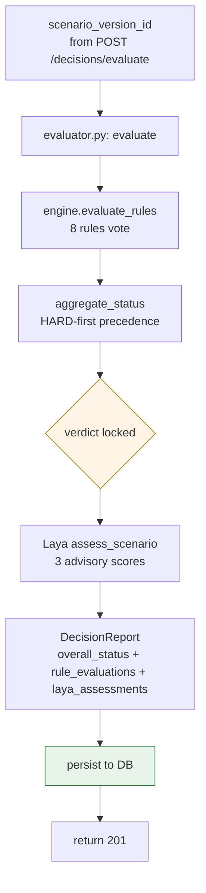

# Chapter 06 — Rule Engine & Decision Aggregation

> *How a scenario gets a verdict, why the LLM is structurally excluded from the verdict,
> and where the Laya boundary lives.*

This chapter is the centre of the product. If you remember only one architectural pattern
from this codebase, make it the rule-first verdict — everything else is there to support it.

---

## 6.1 The shape of a decision



The verdict — `overall_status` — is **immutable** from the moment `aggregate_status`
returns. Every subsequent step (Laya rendering, LLM summarisation, frontend display)
reads it but cannot change it.

---

## 6.2 The verdict enum

```python
class OverallStatus(str, Enum):
    PROCEED              = "proceed"
    PROCEED_WITH_CAUTION = "proceed_with_caution"
    REVISE               = "revise"
    INSUFFICIENT_DATA    = "insufficient_data"
    REJECT               = "reject"
```

Five values, closed set. The frontend maps them to UI tones through a single
`STATUS_LABELS` table (`apps/web/app/(app)/decisions/page.tsx:22`):

```
   PROCEED              → ok    "No significant risks"
   PROCEED_WITH_CAUTION → info  "Caution — soft warnings"
   REVISE               → warn  "Revise assumptions"
   INSUFFICIENT_DATA    → neut  "Insufficient signal"
   REJECT               → bad   "Do not proceed"
```

The status is the *primary* signal. Rule evaluations, Laya scores, and the LLM summary
are *secondary* — they explain it, they don't override it.

---

## 6.3 The eight rules

All eight live in `backend/app/services/rules/engine.py` as pure functions of
`(ScenarioResult, BusinessRead)` returning a `RuleEvaluation`:

| # | Rule ID | Severity | Anchor | What it checks | Logic excerpt |
|---|---------|----------|--------|----------------|----|
| 1 | `MIN_CASH_RESERVE` | HARD | `business.min_cash_reserve` | Min closing cash across the horizon | any month below the configured reserve → BREACHED |
| 2 | `NEGATIVE_CLOSING_CASH` | HARD | `closing_cash` | Going below zero | closing_cash < 0 at any month → BREACHED |
| 3 | `CAPACITY_EXCEEDED` | HARD | `production_capacity` | Production vs. capacity (manufacturing) | asked > capacity → BREACHED |
| 4 | `MATERIAL_SHORTAGE` | HARD | `material_required` | Material feasibility | required > available → BREACHED |
| 5 | `MIN_PROFIT_MARGIN` | SOFT | `business.target_operating_margin` | Operating margin | < margin → WARNING |
| 6 | `NEGATIVE_CONTRIBUTION_MARGIN` | SOFT | `gross_margin` | Contribution margin ≤ 0 | ≤ 0 → WARNING |
| 7 | `UNSOLD_INVENTORY_EXPOSURE` | SOFT | `business.max_unsold_inventory_exposure_pct` | Ending inventory / total investment | ratio > threshold → WARNING |
| 8 | `MISSING_CRITICAL_DATA` | BLOCKER | result shape | Engine output present and invariants intact | `result is None` or `invariants_ok is False` → BREACHED |

Each rule returns `RuleEvaluation{ rule_id, severity, status, detail, related_metric, explanation }`.

`status` is one of:

```
  PASSED         —  rule's condition is not met (i.e. the *good* outcome held)
  WARNING        —  soft rule tripped; scenario is concerning but not fatal
  BREACHED       —  hard rule tripped; scenario is rejected
  NOT_EVALUABLE  —  missing data; cannot make a determination
```

> Notice the axis. `MIN_CASH_RESERVE` is *HARD* but `PASSED` when cash is fine — the
> severity is a label of how serious a *BREACHED* result would be. `PASSED + HARD` is
> exactly the "you have a strong reserve" outcome.

### Display order vs. evaluation order

The `RULES` registry at `engine.py:422` lists rules in display order:

```python
RULES: list[tuple[str, Callable[..., RuleEvaluation]]] = [
    ("NEGATIVE_CLOSING_CASH",      _rule_negative_closing_cash),
    ("MIN_CASH_RESERVE",           _rule_min_cash_reserve),
    ("CAPACITY_EXCEEDED",          _rule_capacity_exceeded),
    ("MATERIAL_SHORTAGE",          _rule_material_shortage),
    ("MIN_PROFIT_MARGIN",          _rule_min_profit_margin),
    ("NEGATIVE_CONTRIBUTION_MARGIN", _rule_negative_contribution_margin),
    ("UNSOLD_INVENTORY_EXPOSURE",  _rule_unsold_inventory_exposure),
    ("MISSING_CRITICAL_DATA",      _rule_missing_critical_data),
]
```

`evaluate_rules` runs all eight and returns them in this order. The display order is a
UX choice (cash rules first because cash failure is the most irreversible) — evaluation
is unconditional.

---

## 6.4 Aggregation precedence

`aggregate_status(evaluations: list[RuleEvaluation]) -> OverallStatus`

```python
# engine.py:438
def aggregate_status(evaluations: list[RuleEvaluation]) -> OverallStatus:
    if not evaluations:
        return OverallStatus.INSUFFICIENT_DATA

    # 1. Any HARD BREACHED → REJECT, regardless of anything else.
    if any(e.severity == RuleSeverity.HARD and e.status == RuleStatus.BREACHED
           for e in evaluations):
        return OverallStatus.REJECT

    # 2. Majority of rules NOT_EVALUABLE → INSUFFICIENT_DATA
    not_evaluable_count = sum(1 for e in evaluations
                              if e.status == RuleStatus.NOT_EVALUABLE)
    if not_evaluable_count >= len(evaluations) / 2:
        return OverallStatus.INSUFFICIENT_DATA

    # 3. Any soft WARNING → PROCEED_WITH_CAUTION
    if any(e.status == RuleStatus.WARNING for e in evaluations):
        return OverallStatus.PROCEED_WITH_CAUTION

    # 4. All PASSED or NOT_EVALUABLE → PROCEED
    if all(e.status in (RuleStatus.PASSED, RuleStatus.NOT_EVALUABLE)
           for e in evaluations):
        return OverallStatus.PROCEED

    # 5. Otherwise (mix of WARNING + PASSED + ...) → REVISE
    return OverallStatus.REVISE
```

### Decision table

```
   ┌───────────────────────────────────┬──────────────────────────┐
   │ inputs                            │ → overall_status          │
   ├───────────────────────────────────┼──────────────────────────┤
   │ any HARD+BREACHED                 │ → REJECT                  │
   │ ≥ ½ NOT_EVALUABLE                 │ → INSUFFICIENT_DATA      │
   │ any SOFT WARNING                  │ → PROCEED_WITH_CAUTION   │
   │ all PASSED or NOT_EVALUABLE       │ → PROCEED                 │
   │ mixed (HARD+SOFT both PASSED)     │ → REVISE                  │
   │ empty list                        │ → INSUFFICIENT_DATA      │
   └───────────────────────────────────┴──────────────────────────┘
```

The `REVISE` bucket exists specifically for the case where the rule set is mixed and
the verdict isn't obvious. It tells the user "the engine cannot bless this; revisit your
inputs." It is **not** the same as `REJECT` (a confirmed refusal) or `INSUFFICIENT_DATA`
(an absence of signal).

---

## 6.5 The `evaluate()` orchestrator

```python
# backend/app/services/decisions/evaluator.py:89 evaluate()
def evaluate(payload, scenario_inputs, scenario_result, business):
    rules = evaluate_rules(scenario_result, business)            # line 96
    overall = aggregate_status(rules)                            # line 97
    laya = assess_scenario(scenario_result.to_dict(),
                           [r.to_dict() for r in rules],
                           getattr(business, "goal", None))       # line 102
    binding_constraints = _extract_binding_constraints(rules)    # hard+breached
    key_risks            = _extract_key_risks(rules)             # soft+warning
    recommendation       = _build_recommendation(overall)         # by status
    caveats              = [...]
    return DecisionReportRead(id="", overall_status=overall,
                              rule_evaluations=rules,
                              laya_assessments=laya,
                              binding_constraints=binding_constraints,
                              key_risks=key_risks,
                              recommendation=recommendation, ...)
```

The order matters. Rules → verdict → Laya → presentation. If the verdict was loaded
after Laya, a Laya score could rationalise a verdict that should have been rejected.

`_build_recommendation` (`evaluator.py:58`) keys on `overall_status` and produces
domain-appropriate copy:

| Status | Recommendation |
|---|---|
| `PROCEED` | "No binding constraints detected. The scenario is within policy." |
| `PROCEED_WITH_CAUTION` | "Scenario proceeds; address the soft warnings listed below before sign-off." |
| `REVISE` | "Mixed rule outcomes — revisit inputs or thresholds." |
| `INSUFFICIENT_DATA` | "Provide the missing inputs to enable evaluation." |
| `REJECT` | "One or more hard constraints failed — the scenario cannot proceed as written." |

`_extract_binding_constraints` returns rules with `severity == HARD and status == BREACHED`.
`_extract_key_risks` returns rules with `status == WARNING`. These are the lists the UI
promotes above the rest.

---

## 6.6 The Laya boundary

Laya sits in a separate service (`backend/app/services/laya/adapter.py`) and is purely
advisory. The contract:

```python
def assess_scenario(
    result_dict: dict,
    rule_evaluations: list[dict],
    business_goal: str | None,
) -> list[LayaAssessment]:
    """
    Returns 3 LayaAssessment records by default.
    Never raises; on import failure returns 3 records with status='unavailable'.
    """
```

The three default questions (`default_questions(industry)`):

| Question | Kind | Output |
|---|---|---|
| `risk_category` | CHOICE | low / medium / high |
| `feasibility_score` | SCORE | 1–5 |
| `aligns_with_goal` | NOUL | yes / no / unclear |

These are surfaced in the decision detail page as a "soft assessment" panel *below* the
rule evaluation table. **The UI makes the boundary explicit**:
`apps/web/app/(app)/decisions/[id]/page.tsx:230-250` renders the Laya scores and a
note that they are advisory.

### What Laya is for

- A *second opinion* on qualitative dimensions (feasibility, business alignment) that
  the rule engine cannot judge from numbers alone.
- A way to capture a stakeholder's *concern* without re-running the engine.
- A consistency check between expert intuition and rule verdict — if Laya says
  `risk_category=high` while rules are all `PASSED`, the user gets a prompt to dig deeper.

### What Laya is not for

- **Never a vote.** Even if Laya returned `risk_category=high`, the overall verdict does
  not move from `PROCEED` to anything else. The verdict is rule-first, period.
- **Never required.** A missing Laya import (the package is optional) yields
  `status='unavailable'` answers that the UI renders as such.

### Implementation detail

```python
# backend/app/services/laya/adapter.py:67
try:
    from laya import Router      # deferred import; raises ImportError if not installed
    _laya_available = True
except Exception:
    _laya_available = False

# backend/app/services/laya/adapter.py:109
if not settings.has_laya:
    return [
        LayaAssessment(question=q, status="unavailable", rationale="…")
        for q in default_questions(industry)
    ]
```

This is the "graceful degradation is structural" pattern — see Principle 4.

---

## 6.7 Why the LLM is on a separate endpoint

The decision evaluator does **not** import any LLM provider. The LLM produces an
`Explanation` *record* on a separate endpoint:

```
POST /api/decisions/{id}/explain         ◄── late, on user click
        │
        ▼
   get_provider(mode) → LlmFactory
        │
        ▼
   build ExplanationContext (FROZEN payload)
        │
        ▼
   provider.explain(context) → Explanation
        │
        ▼
   persist LlmExplanation row (1:1 with DecisionReport)
```

Three structural protections prevent the LLM from changing a verdict:

```
   1. The decision evaluator does not import providers/*.
   2. /decisions/{id}/explain creates an Explanation row, not a verdict row.
   3. The UI's decision detail page renders the verdict FIRST, the Laya second,
      the LLM summary THIRD with an explicit disclaimer:
      "The LLM can only explain. Rule verdicts and binding constraints above
       are authoritative."
```

The third one is cosmetic but powerful — it makes the authority ordering visible to the
user, so they don't conflate a confident LLM summary with a strong verdict.

---

## 6.8 The decision detail page UX

The detail page (`apps/web/app/(app)/decisions/[id]/page.tsx`) renders:

```
┌──────────────────────────────────────────────────────────┐
│  ← back    Decision report           [Explain with LLM]   │
│                                                          │
│  Overall status:  REJECT  (badge)                        │
│  Recommendation:  "One or more hard constraints…"         │
│                                                          │
│  ┌─ BINDING CONSTRAINTS ───────────────────────────────┐  │
│  │ • NEGATIVE_CLOSING_CASH       actual -$4,200        │  │
│  │                                       month 2       │  │
│  │                                       threshold $0  │  │
│  │   "Closing cash went below zero at month 2…"        │  │
│  └─────────────────────────────────────────────────────┘  │
│                                                          │
│  ┌─ RULE EVALUATIONS ──────────────────────────────────┐  │
│  │ Rule                  Sev    Status   Actual  Thresh │  │
│  │ NEGATIVE_CLOSING_CASH HARD  BREACHED  -$4.2k  $0     │  │
│  │ MIN_CASH_RESERVE      HARD  BREACHED  -$4.2k  $10k   │  │
│  │ MIN_PROFIT_MARGIN     SOFT  WARNING   3.1%    10.0%  │  │
│  │ ...                                                   │  │
│  └─────────────────────────────────────────────────────┘  │
│                                                          │
│  ┌─ LAYA SOFT ASSESSMENT (advisory) ───────────────────┐  │
│  │ Risk category: high                                  │  │
│  │ Feasibility:  2/5                                   │  │
│  │ Aligns with goal: no                                │  │
│  └─────────────────────────────────────────────────────┘  │
│                                                          │
│  ┌─ ASSUMPTIONS / CAVEATS / MISSING INFO ─────────────┐  │
│  │ …                                                   │  │
│  └─────────────────────────────────────────────────────┘  │
│                                                          │
│  ┌─ LLM EXPLANATION  (lazy, on click) ────────────────┐  │
│  │ [Explain with LLM] →                                │  │
│  │ "This scenario fails because cash goes negative…"  │  │
│  │ ⚠ The LLM can only explain. The verdict above is   │  │
│  │   authoritative.                                    │  │
│  └─────────────────────────────────────────────────────┘  │
│                                                          │
│  [Print]                                                 │
└──────────────────────────────────────────────────────────┘
```

This order is policy: rule table first, every other element is below it. The CSS even
hides it on print via the `.no-print` class so a printed decision is *just the rules
and the verdict*.

---

## 6.9 API surface

```
POST /api/decisions/evaluate
   body: { scenario_version_id: UUID }
   returns: 201 DecisionReportRead
   notes:   · Reads scenario_version.inputs_json and result_json
            · Falls back to running the scenario if result_json is missing
              (e.g. for newly imported data) — see runner.py dispatch

GET /api/decisions
   returns: list[DecisionReportRead]

GET /api/decisions/{id}
   returns: DecisionReportRead

POST /api/decisions/{id}/explain
   body: { provider_mode?: "local" | "openai" | "anthropic" | null }
   returns: Explanation | 503 if no providers available
   notes:   · Stores LlmExplanation row idempotently
            · Same input → same output (deterministic given the model)
            · Errors degrade to explanation.status="unavailable"
```

`/explain` is intentionally idempotent on first-success. A second call with the same
provider returns the cached `LlmExplanation`. The user can force a refresh by passing
an alternate `provider_mode`.

---

## 6.10 The caching question

A scenario result with `engine_version == "0.1.0"` is stored once and referenced many
times. Decisions on older scenarios:

- Re-run with the current engine if `engine_version` differs from `RULE_VERSION`.
- Use the cached result otherwise.

`RUNNER_VERSION = "0.1.0"` (`runner.py:48`), `RULE_VERSION = "0.1.0"`
(`engine.py:25`). The orchestration policy ("when to re-run") is documented in
`app/api/decisions.py` and isn't something to change without a migration plan.

---

## 6.11 Extending this

### Adding a new rule

1. Write `_rule_<id>(result: ScenarioResult, business: BusinessRead) -> RuleEvaluation`
   in `app/services/rules/engine.py`.
2. Register it in the `RULES` list at the position you want it to appear in the UI.
3. Add a Pydantic mirror of any new status field to `app/schemas/decision.py` and the
   Zod mirror in `apps/web/lib/schemas.ts`.
4. Update `aggregate_status` if the new rule needs its own severity logic (rare; the
   default precedence still applies).
5. Add an entry to the table at the top of this chapter.
6. Test the rule in isolation (`tests/test_rules.py`) and across industries
   (`tests/test_simulation.py`).

### Adding a new verdict

> Consider carefully. Once you add a sixth value, every UI tone mapping, every
> downstream consumer, every external integration in `formatMetricsSummary()` needs
> to know about it. The five we have cover every decision scenario the engine
> currently identifies; we should not grow this without good reason.

If you must:

1. Add to the `OverallStatus` enum in `app/schemas/decision.py`.
2. Add a mapping entry in `apps/web/app/(app)/decisions/page.tsx:22` `STATUS_LABELS`,
   `STATUS_TONES`.
3. Add a branch in `aggregate_status`.
4. Add a recommendation branch in `_build_recommendation`.
5. Update the milestone reporting and the decision-detail UX to surface the new status.

### Replacing the verdict algorithm

The aggregation function is one of three places that must remain in lockstep with the
enum and the UI tone map. The other two are the LLM prompt and the dashboard's
`decision-journal` rollup. Any change to the aggregation algorithm **must** be paired
with a clear migration story and (in production) a versioning flag.

---

## 6.12 The behaviour contract as a one-screen reminder

```
   ┌──────────────────────────────────────────────────────────────────┐
   │   input: a (frozen) ScenarioResult + BusinessRead                │
   │                                                                  │
   │   evaluate_rules(result, business)                               │
   │       → 8 × RuleEvaluation                                       │
   │   aggregate_status(evals)                                        │
   │       → OverallStatus    ◄── verdict is now FIXED                │
   │   assess_scenario(...)                                           │
   │       → 3 × LayaAssessment   ◄── advisory only                   │
   │   render(binding_constraints, key_risks, recommendation)         │
   │       → DecisionReport                                          │
   │                                                                  │
   │   verdict cannot be changed by:                                  │
   │       Laya                                                       │
   │       LLM (different endpoint, different record)                 │
   │       recommendation copy                                        │
   │       any subsequent computation                                 │
   │                                                                  │
   │   verdict may change between calls only because:                 │
   │       inputs changed (scenario version bumped)                   │
   │       engine_version bumped (re-run)                             │
   │       business config changed (re-run)                           │
   └──────────────────────────────────────────────────────────────────┘
```

This is the contract. Memorise it.

---

*Next: [Chapter 07 — LLM providers & Laya adapter](07-llm-and-laya.md)*